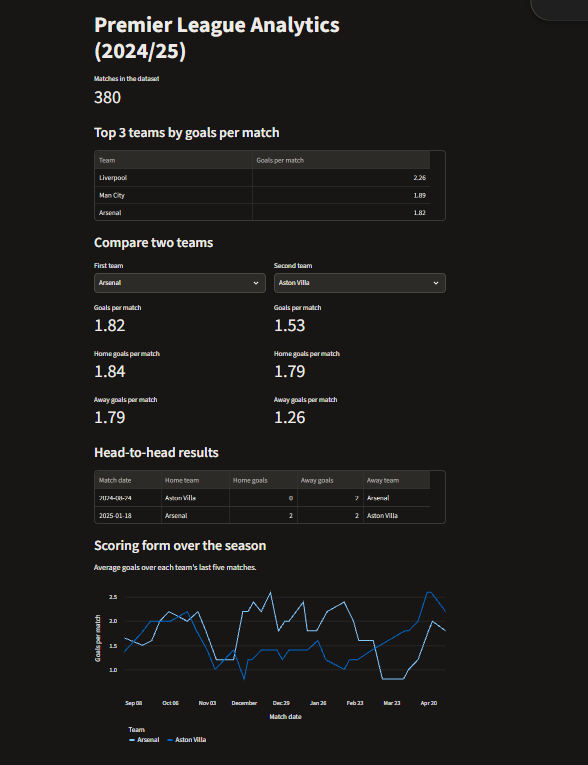

# Premier League Analytics

An interactive dashboard for exploring 380 matches from the 2024/25 Premier League season. Built by Rayan Rehou as an independent portfolio project.



## What you can explore

- See the three clubs with the highest goals per match.
- Compare any two clubs' overall, home, and away scoring averages.
- View their head-to-head scores and match dates.
- Follow each club's scoring form with a rolling average over its latest five matches. The opening four matches use the results available at that point.

## How it works

`main.py` uses Pandas to read the CSV, standardize the dates, and build the SQLite database. `app.py` queries the database and displays the results in Streamlit. SQL calculates the rankings, venue averages, and rolling scoring averages.

## Run locally

Download the [2024/25 Premier League CSV](https://www.football-data.co.uk/mmz4281/2425/E0.csv) from Football-Data.co.uk. Create a folder named `Data` in the project folder and save the CSV as `Data/premier_league_2024_25.csv`.

From the project folder on Windows, run these commands in PowerShell.

```powershell
py -m venv .venv
.\.venv\Scripts\python.exe -m pip install -r requirements.txt
.\.venv\Scripts\python.exe main.py
.\.venv\Scripts\python.exe -m streamlit run app.py
```

Open the local URL printed in the terminal. Run `main.py` again whenever you need to rebuild `football.db`.

## Data source

Match results come from [Football-Data.co.uk](https://www.football-data.co.uk/).
